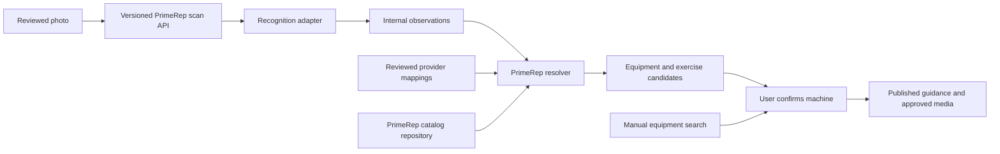

# Part 12 — Gym equipment scanning

Proposed implementation plan, November 7, 2026. This document plans the feature; it does not select a provider, enable scanning, or claim that recognition or approved media coverage already exists.

## Outcome and scope

Photograph equipment → review the photo → identify possible machines → confirm a PrimeRep equipment entry → choose among compatible exercises → read published instructions and watch an approved demonstration when available.

One machine can support several exercises. Every result requires an explicit machine confirmation in the first release, including high-confidence results. Uncertain, unsupported, blurry, or multiple-machine images lead to possible matches, retake, or manual search. Recognition never selects an exercise, changes a workout, or updates the user's saved equipment automatically.

Start from frontend `3db343f` (merged PR #112) and backend `805ff5c` (merged PR #31), fetched from `origin/main`. Work in the two `feat/gym-equipment-scanning` branches under `.worktrees/gym-equipment-scanning/{frontend,backend}`. The original checkouts, their unrelated changes, and every workout-reliability-monitoring worktree are outside this task. Do not rebase, modify, or run services from those worktrees.

The first delivery covers a still-photo flow on iOS and Android with separate device acceptance gates. Web starts with manual equipment search; webcam capture is a later decision. Use the existing photo-picker dependency rather than introducing a live-camera subsystem. Open-ended image Q&A, automatic workout insertion, machine-specific weight histories, and a new exercise-library import are separate work.

## Phase 0 — Documentation discovery and baseline

Completed source discovery for this plan; runtime, deployed catalog coverage, and device checks remain implementation work.

| Foundation | Verified source and allowed pattern | Consequence |
| --- | --- | --- |
| Owned identities | `app/models/exercise.py:65–116`; `app/models/equipment.py:7–25` | String IDs already exist independently of display names. Preserve them. |
| Many-to-many equipment | `app/models/exercise.py:19–36`; `app/core/workout_service.py:495–521` | A single equipment match is insufficient: all requirements must be available. |
| Aliases and catalog updates | `app/models/workout_template.py:173–180`; `app/core/exercise_catalog_service.py:40–58,110–137` | Aliases and renames can retain identity; meaningful movement changes require a new ID. |
| Revision and media approvals | `app/core/exercise_catalog_service.py:61–140,178–256`; `app/models/exercise_catalog.py:9–89` | Publish through existing exact-revision/hash reviews, not recognition output. |
| Public exercise reads | `app/api/v1/exercises/router.py:73–118,187–207`; `app/core/exercise_service.py:13–35,177–204` | Existing visibility includes legacy content; add a stricter scan-guidance projection. |
| Equipment read | `app/api/v1/equipment/router.py:12–16`; `app/schemas/equipment.py:6–22` | Current endpoint returns the active catalog; add a separate bounded search rather than changing its shape. |
| Safe image ingestion | `app/api/v1/users/profile_router.py:51–67`; `app/core/profile_service.py:78–107` | Copy streaming limits, decode/MIME verification and fresh encoding; not avatar sizing/storage. |
| Authenticated limiting | `app/core/rate_limit.py:13–35`; `app/api/v1/exercises/router.py:145–152` | Reuse authenticated limiter conventions; production limits must work across replicas. |
| Flags and access | `app/core/feature_flag_service.py:15–19,89–98`; `app/core/subscription_service.py:103,247–256` | Current flags are purchases/enforcement/onboarding. A scan flag and scan access policy are new. |
| Historical identity | `app/models/workout_session.py:28`; `app/models/workout_template.py:114,195`; `docs/exercise-content-foundation-plan.md:11–30` | Keep IDs and saved snapshots; no bulk history migration. |
| Mobile normalization | Frontend `services/exerciseService.ts:34–114,201–216`; `interfaces/exercises/types.ts:1–158` | Normalize public contracts in services and keep PrimeRep IDs unchanged. |
| Photo lifecycle | Frontend `app/profile/edit.tsx:23–94`; `services/privateFiles.ts:12–44`; `services/accountScope.ts:1–15` | Copy account fencing, normalization and cleanup; use a scan-specific request service. |
| Playback | Frontend `components/exercises/ExerciseMedia.tsx:21–85` | Reuse playback behavior only with strict approved-media inputs; its legacy fallback is not approval evidence. |
| Camera configuration | Frontend `app.json:37`; `package.json:42–55` | ImagePicker 17 and ImageManipulator 14 exist; camera permission is explicitly disabled and needs a new native build. |

Camera API references are pinned to Expo SDK 54 source: [ImagePicker.ts](https://github.com/expo/expo/blob/sdk-54/packages/expo-image-picker/src/ImagePicker.ts#L53), [ImagePicker.types.ts](https://github.com/expo/expo/blob/sdk-54/packages/expo-image-picker/src/ImagePicker.types.ts#L343), and [config plugin](https://github.com/expo/expo/blob/sdk-54/packages/expo-image-picker/plugin/src/withImagePicker.ts). Allowed APIs include `getCameraPermissionsAsync()`, `requestCameraPermissionsAsync()`, `launchCameraAsync(options)`, `launchImageLibraryAsync(options)`, and the `canceled/assets` result union. The public v54 documentation URLs currently redirect to newer SDK docs; do not copy newer APIs without checking installed types.

Known gaps: no scan implementation, provider mappings, canonical replacement workflow, scan flag, calibrated confidence, or scan entitlement policy exists. Source inspection cannot establish live approved-content/video coverage. `catalog_version(db)` covers content/media publications, not standalone equipment aliases, lifecycle decisions, or mappings.

## Architecture and identity rules



- Keep existing exercise/equipment IDs. Never regenerate a slug because a name changes, or use a provider's ID as a workout identity.
- Define typed mapping boundaries: within each equipment/exercise namespace, `(provider, external_id) → PrimeRep ID`. Separate tables with real foreign keys are preferable to a polymorphic unvalidated target string. Add equipment mapping storage when the chosen adapter supplies stable external IDs; add exercise mappings only if an exercise provider is actually integrated. A name-only model label is an observation, not an external ID.
- Mapping records carry mapping version, source/review provenance, active state, and an audited change trail. A broad or ambiguous provider category stays unresolved or maps to a truthful broad catalog entity; it must not silently map to a more specific machine.
- Recognition adapters accept normalized image bytes and return bounded internal observations: machine labels, optional provider references, visible configuration clues and optional provider scores. Adapters expose no database session, ORM rows, public video URLs, or exercise publishing operations.
- The resolver depends on a catalog-repository interface returning internal DTOs. The current SQLAlchemy repository implements that interface; HTTP schemas serialize PrimeRep DTOs. Neither the client nor the provider adapter imports storage models.
- Resolve reviewed mappings first, then exact normalized names/aliases, then bounded ranked text matching. Preserve ambiguity, deduplicate by PrimeRep ID, and use stable ID tie-breaking. Model-supplied IDs are untrusted and must be resolved/validated server-side.
- Keep separate `equipment_revision`, `mapping_revision`, `resolver_version`, and existing content/media `catalog_version`. Changes invalidate affected cached results. API versioning is independent of database migration or vendor versions.

### Renames, retirement, replacement and semantic changes

Renames/content corrections retain IDs. Compare reviewed movement, laterality, tracking mode and load interpretation before publication/import: materially different exercises get new IDs; missing legacy metadata can be enriched with review. Enrichment must not reinterpret old logged weights or infer a historical load basis from today's metadata. If review reveals incompatible semantics, create a new identity and retain the old interpretation/snapshots. Similar names, muscles, or images never establish identity equivalence. Existing substitution checks are not merge checks.

Use soft retirement (`is_active=False`) and retain old rows, revision records, favorites/references and historical snapshots. If a replacement is needed, record an explicit reviewed relationship and reason without rewriting old references or aggregating statistics across IDs. An equivalent duplicate and a non-equivalent alternative must be distinguishable. The resolver excludes retired targets from new candidates and does not silently follow replacement links. Operators review/repoint affected mappings and new-selection paths separately. Hard deletion and automatic canonical merging are outside the initial operator workflow.

## Proposed versioned API contract

All routes below are **new proposals**, not existing APIs. Freeze OpenAPI schemas and shared fixture examples in Phase 1 before implementing transport. Responses contain only owned IDs and public presentation fields, never provider payloads or ORM objects. Use snake_case and explicit `schema_version: 1`.

| Route | Contract |
| --- | --- |
| `POST /v1/equipment-scans` | Authenticated bounded JPEG/PNG bytes, explicit upload action, `Idempotency-Key`. Synchronous normalized result within the server deadline. |
| `GET /v1/equipment/search?q=...&limit=20&cursor=...` | Additive manual search by names/aliases, active equipment only; bounded query and deterministic opaque cursor. Preserve `GET /v1/equipment`. |
| `GET /v1/equipment/{equipment_id}/exercise-options?limit=20&cursor=...&available_equipment_ids=...` | Current canonical exercise choices and missing requirements for a confirmed machine; validate/cap all supplied IDs. |
| `GET /v1/exercises/{exercise_id}/guidance` | Current scan-safe instructions and approved media, with explicit availability/provenance. Existing exercise detail remains backward compatible. |

Representative scan result (IDs/names below are illustrative; fixtures must use actual catalog entries):

```json
{
  "schema_version": 1,
  "scan_id": "opaque-attempt-id",
  "status": "candidates",
  "requires_confirmation": true,
  "versions": {
    "catalog_version": "content-media-version",
    "equipment_revision": "equipment-version",
    "mapping_revision": "mapping-version",
    "resolver_version": "resolver-version"
  },
  "candidates": [{
    "equipment": {"id": "primerep-equipment-id", "name": "Catalog machine name"},
    "confidence": {"level": "medium", "score": null},
    "exercise_candidates": [{
      "exercise_id": "primerep-exercise-id",
      "name": "Catalog exercise name",
      "compatibility": "needs_equipment_confirmation",
      "missing_equipment_ids": ["required-attachment-id"],
      "guidance_available": false,
      "approved_video_available": false
    }]
  }],
  "manual_search_available": true
}
```

- Successful recognition status is `candidates` or `no_match`. A `no_match` response has no candidates and a bounded `reason`: `not_equipment`, `multiple_subjects`, `image_unclear`, `unsupported_equipment`, or `uncertain`. A valid unsupported image can return `no_match`; an invalid upload, content-policy rejection, denied access or provider outage is an error, not an invented match. Candidates require `reason: null` or an omitted reason.
- Initial bounds: at most five machine candidates and three exercise previews per candidate; subsequent exercise pages contain at most 20 options. Use indexed, bounded catalog/mapping reads; no full exercise catalog in the mobile bundle or provider prompt.
- Confidence is per equipment candidate, with `high|medium|low|unknown` and nullable score in `[0,1]`. Uncalibrated provider scores stay internal; return `null` rather than a fabricated probability. Record confidence provenance/model version internally. Exercise compatibility is a deterministic catalog check, not a second visual-confidence claim.
- First-release guidance contains only an active canonical exercise with a currently published revision and its verified publication record. Return explicit `instructions_unavailable` for legacy/unreviewed text. Video descriptors require current published media and valid approval/rights state; otherwise return `video_unavailable`. A published instruction set may exist without a video.
- Never expose draft/private exercises, review identities, rights documents, provider labels or provider video URLs. Revalidate current content at display time and honor withdrawals; receipt caches contain identity results, not permanent media permissions.
- Include a stable structured error code plus readable detail and request ID. Define `401`, policy-specific `403`, unavailable/retired `404`, changed idempotency payload `409`, active-account attempt `409 scan_in_progress`, stale receipt `409 scan_result_stale`, size `413`, media type `415`, malformed image `422`, content rejection `422 scan_image_not_allowed`, quota/budget `429` with retry information, and provider unavailable/deadline `503/504`. The client always retains the manual-search entry.
- Cursor continuation is bound to the relevant catalog/search version. An expired cursor asks for refresh without mixing snapshots.

## Phase 1 — Catalog contract, identity and coverage

**Implement:** Copy strict Pydantic models from `app/schemas/exercise_catalog.py:38–109` for the new scan DTOs and contract fixtures. Implement repository queries around the existing many-to-many relationship and `required <= available` compatibility rule. Add bounded equipment name/alias search. Audit a small agreed machine cohort against real catalog IDs, required attachments, movement/tracking/load semantics, published revisions and approved media. Include multi-function cable stations and confusing lookalikes in the cohort. Add strict guidance projection without changing legacy endpoint behavior.

Define mapping/lifecycle repository interfaces and reviewed import/report formats. Introduce only additive storage required by the initial adapter and lifecycle operations; keep existing IDs, relationships and database layout. Return missing requirements instead of asserting readiness. User-owned equipment is a hint; confirm the equipment/attachments available at the current gym before calling an exercise compatible.

**References:** Discovery table; `docs/exercise-content-foundation-plan.md:11–42`; `tests/test_exercise_catalog.py:99–114,190–264`; frontend normalization functions above.

**Verify:** Contract fixtures have stable owned IDs and bounded pages; one machine yields several exercises; additional attachments are reported; private/draft/inactive records stay excluded; legacy URLs cannot acquire approved status; rename/retirement/replacement scenarios preserve active/completed workout snapshots and prior weights. Report coverage gaps honestly.

**Guards:** No ID rewrite, provider-derived taxonomy, automatic merge, invented approval, or existing-list response break. Do not publish new content merely to satisfy a scanner demo.

## Phase 2 — Provider-neutral resolver and adapter fixtures

**Implement:** Build internal `RecognitionAdapter` and `CatalogRepository` protocols, normalized observations and deterministic resolver functions. These names are planned interfaces, not existing APIs. Start with fixture adapters for known, ambiguous, unmapped, multi-function and unsupported machines. Validate adapter output length/schema and treat image text/model output as data, never executable instructions. Add reviewed mapping validation/reporting only where external IDs exist.

**References:** `app/core/exercise_catalog_service.py:31–58` for validated catalog ingestion boundaries; existing aliases and compatibility sources from Phase 0. Keep recognition separate from `exercise_catalog_service` publication commands.

**Verify:** Two fixture providers with different output shapes resolve to the same owned IDs; missing/retired/incorrect mappings produce an unresolved result; provider switches require a coverage/mapping report; malicious/oversized output cannot create IDs or content; differing load/tracking semantics stay separate.

**Guards:** No provider selection, provider SDK in UI/core DTOs, external exercise-library requirement, blind fuzzy-match acceptance, or score treated as calibrated confidence.

## Phase 3 — Safe scan transport, access and rollout control

**Implement:** Copy bounded streaming/decode/re-encode patterns from profile upload into a dedicated scan service. Enforce the image, content, concurrency and spending rules below before enabling a real adapter. Apply actual decode verification, EXIF orientation, fresh encoding without metadata and a server recognition deadline below the client's timeout. Start synchronous; queue/job infrastructure is justified only by measured latency requirements.

### Image, abuse and cost guardrails

These are planned acceptance requirements, not implemented protections. Resolution, encoding and pilot quotas below are initial benchmark candidates; provider selection, spending approval and measured quality remain release gates.

**One photo and one primary machine:** Disable multiple selection, require exactly one image asset and show a preview with “One machine per photo.” One clearly framed machine may have other equipment in the background; several equally prominent machines, collages or screenshots containing multiple targets ask for a retake. The server accepts exactly one decoded, single-frame JPEG/PNG image, never image arrays, multi-file submissions, animated/multipage containers, videos, documents or client-supplied URLs. Device HEIC/library formats are converted locally before upload. File type is checked against actual decoding, not just MIME/filename. Keep the proposed 5 MiB received-byte and 20-million-decoded-pixel limits, bounded decoder resources and cleanup on every exit.

**Reduce pixels without removing useful evidence:** Benchmark longest-edge bounds of 768, 1024 and 1536 px against a higher-quality reference. Start evaluation at 1024 px and JPEG quality around 0.8, preserving aspect ratio and the whole machine; never upscale, apply an avatar crop or automatically remove identifying attachments. The proposed provider-image ceiling is 1536 px, with the final size chosen from held-out accuracy, attachment/label readability, image-token usage and latency. Recheck and normalize on the server even if the client claims it already resized. Strip metadata after applying orientation, including location data. Compression reduces transferred bytes; provider billing can depend on pixel patches/tiles and model-specific detail settings, so smaller file bytes or a setting named `low` do not establish a lower bill. Select and pin the actual provider/model settings after measurement. Do not silently pay for a second, larger inference after an uncertain result; offer an explicit clearer-photo retry or manual search.

**Separate safety from equipment recognition:** Validate bytes and access first. Run the selected image-safety screening before the general recognition call, verifying its image-category coverage, privacy terms and failure behavior. Safety rejection returns a generic actionable error without recognition; safety-service failure does not bypass the gate. A moderation pass does not mean the image depicts gym equipment, and moderation cannot guarantee detection of every harmful image. Combine the equipment/no-equipment decision with the bounded recognition request instead of adding a separate paid “is this equipment?” call by default. Require a clear primary gym-equipment subject before resolving candidates. Non-equipment, unsupported equipment, poor visibility and ambiguous subjects return the owned reason codes above, without invented matches. Treat image text and provider output as untrusted data, never instructions; allow no browsing, external tool calls, open-ended Q&A or provider-generated exercise guidance. User confirmation and current catalog compatibility checks still apply after recognition. Some rejected photos require external visual analysis and may incur cost; never describe all rejected uploads as free.

**One admitted scan per account:** Enforce one active scan across devices and backend replicas, including safety screening and recognition, with an atomic account/environment reservation. Different simultaneous keys return `scan_in_progress`; they do not queue additional provider work. Disable Identify while pending in the UI, but enforce this on the server as well. Repeated taps and network retries reuse the same attempt key. Use an account/environment-scoped, keyed fingerprint of normalized content to reuse an existing current result for the same image during the 15-minute receipt window, even if a repeated submission has a new key. Do not share photo fingerprints or results across users; invalidate reuse when catalog/mapping/model/normalization versions change. Retain only bounded result/reason/version metadata and the short-lived fingerprint, never the photo. Retakes create a new explicit submission. Client cancellation does not prove external processing or billing stopped; settle reservations conservatively and do not launch an automatic retry/fallback when the external outcome is unknown.

**Bound attempts and spending:** Proposed internal-pilot limits are three accepted attempts per minute and twenty per day per account, plus a configured global concurrency cap. They are configurable product limits, not a promise for paid/free access. Invalid submissions still face route abuse throttling; no-match, blocked and failed accepted attempts consume the attempt allowance, so deliberately unsuitable photos cannot buy unlimited checks. Identical idempotent receipt replays do not consume another provider attempt. Reserve shared daily/monthly spend conservatively before any external step, including safety screening where billed, image input, text output and any reasoning tokens. Fail closed to new admissions when the approved cap, pricing configuration or reservation service is unavailable; leave manual discovery usable. Cap all billable output and request only short structured results. One recognition invocation per admitted attempt is the default; no automatic provider fallback, quality escalation or billable retry. Keep uncertain charges reserved until reconciled, rather than immediately refunding a timeout. Provider-console alerts supplement application admission controls; do not assume an alert is a hard spending stop. Numeric global budgets remain unset and real scanning disabled until approved; the previously discussed $25 test allowance is a proposal, not spending authorization.

**Measure quality and cost together:** Compare identical held-out gym photos at each proposed resolution, including crowded gyms, lookalikes, attachments, labels, blur, unrelated subjects and content-policy fixtures. Choose the smallest configuration meeting agreed false-match, useful-match and safety-screening thresholds; retaining more resolution is preferable when smaller images fail those thresholds. Test bypasses, multiple files/frames, oversized decompression, duplicate images/keys, two devices/replicas, disconnects, timeouts and concurrent budget exhaustion. Verify rejects stop at the intended stage, duplicates do not create another charge, and refused/ambiguous subjects never become confirmed matches. Record only aggregate reason counts, model/settings version, billed usage/cost, latency and useful-match/retake rates; no photos, image text or raw provider responses in logs/analytics. Verify provider usage against reservation estimates and cost per useful confirmed match, not only cost per call.

References: [OWASP file upload guidance](https://cheatsheetseries.owasp.org/cheatsheets/File_Upload_Cheat_Sheet.html), [official OpenAI image sizing and billing documentation](https://developers.openai.com/api/docs/guides/images-vision), and [image moderation capabilities and supported-category limits](https://developers.openai.com/api/docs/guides/moderation). These inform validation and evaluation; they do not select OpenAI or establish gym-recognition accuracy. Confirm the selected provider's current policies before integration.

Use a short-lived, user/environment-scoped attempt receipt for idempotency and duplicate in-flight detection, containing normalized candidate IDs/status/version metadata, no image or provider body. Reject a reused key with a different bounded payload fingerprint. Expire receipts after a proposed 15 minutes, purge on account deletion, and reject stale catalog/mapping versions on replay. Check authorization, quota and the default-off `equipment_scanning_enabled` flag before provider work. Shared quota/in-flight accounting must not rely on one process's memory; reserve attempts atomically and specify failed-attempt accounting. Do not hold catalog/subscription database locks during network calls.

Resolve against a coherent current catalog/mapping snapshot after the provider returns and revalidate versions before storing the receipt. A change during resolution can retry the local resolver using the same in-memory observations, without another provider call, or return `scan_result_stale`. Replaying a stale receipt never reruns recognition automatically: offer current manual search or an explicit user retry with a new key and the normal quota check.

Extend the existing audited flag/admin/override pattern additively. Master OFF cancels new recognition admissions while manual search and published catalog guidance remain usable. It must not alter subscription launch clocks, purchases, onboarding enrollment or workout admission. Old mobile clients and old audit snapshots tolerate the additive field. Recheck rollout access on explicit retry; a client-side flag never authorizes a scan.

Before a real adapter is enabled, decide the scan access policy. Premium inclusion is a proposal, not established by the subscription teaser; explicitly decide transition grants, trial/free quotas and expired access. Implement a dedicated scan access check using server-verified subscription state if that policy is chosen. Do not copy `require_training_access` as an implicit product decision.

**References:** Upload/limiter sources in Phase 0; current three-flag registry, versioned patches and audience overrides; `app/core/subscription_service.py:103,247–256` for existing boundaries.

**Verify:** Invalid/oversized/multiple-frame images stop before external calls; safety rejection stops recognition; non-equipment and unclear-primary-subject results have no candidates. Two replicas enforce account concurrency, quotas, idempotency and global spend reservations; repeated normalized photos reuse only current same-account receipts. Cross-account receipts are inaccessible; retries do not duplicate in-flight work; timeout/cancellation/account deletion clean temporary files and settle reservations conservatively. Flag OFF prevents admission; subscription clocks and logging/resume/finish contracts remain unchanged. Test migrations only in disposable databases.

**Guards:** No client-supplied remote image URLs, public photo bucket, raw-photo analytics, automatic billable retries or in-request DB locks across provider calls. Copy image validation principles, not avatar persistence or square crops.

## Phase 4 — Photo, confirmation and guidance UI

**Implement:** Add an Explore entry and protected scanner route using the existing route/row/footer patterns. Implement Take photo / Choose photo → preview → explicit Identify action → cancellable pending state → possible machines → confirmation → exercise choices → published guidance. Keep None of these, retake and manual search visible. An unavailable platform, denied camera permission, no match, quota or provider outage has an actionable manual path. Offline, show reconnect/retry and keep the search entry available; optionally display cached names as unverified browsing hints, but require connection for current matching, compatibility and publication checks. Do not promise authoritative offline search or guidance.

Use existing ImagePicker APIs after a user gesture, with multiple selection disabled and exactly one returned image required. Show “One machine per photo” and the reduced-image preview before explicit submission. Preserve full machine shape rather than the avatar's square crop. Normalize locally with ImageManipulator using the benchmark-selected settings, retain a local preview only for the current session, and discard temporary copies on retake, exit and logout. Disable duplicate submission while pending; reopening the route does not bypass the server's account-wide active attempt. Camera/photo permission messaging must describe scanning; keep microphone permission disabled. Build a new native binary. On Android include system-activity recovery/account fencing before upload. Web offers manual search initially.

Create `services/equipmentScanService.ts` to normalize the versioned response and own caller cancellation/request sequencing. Reuse account-generation guards so late responses from a prior account, photo or route cannot appear. Existing transport timeout controllers do not expose caller cancellation, so add the narrow required transport support with existing callers preserved. Client cancellation does not promise that a provider has stopped; the backend deadline and quota still apply.

Reuse ExerciseMedia's player behavior with approved-only inputs and a scan-safe guidance view; do not route into a legacy-fallback view while claiming its content is approved. Show additional equipment and missing demo/instruction states plainly. Keep training changes behind the existing explicit workout actions and admission checks.

**References:** Frontend files in Phase 0; `components/equipment/equipment-card.tsx:27–155`; `components/exercises/CatalogPageFooter.tsx:5`; `app/_layout.tsx:374–424`; pinned SDK sources.

**Verify:** Mounted flow tests cover permission deny/cancel, retake races, account switch, back/foreground, low confidence, multiple options, manual search, extra equipment and unavailable media. Physical iOS and Android checks cover capture/library/orientation, native permissions, slow network, cleanup, small screens, light/dark, large text and screen readers. Browser tests cover the manual path. No production photos or user credentials are needed for fixture tests.

**Guards:** No background capture, gallery auto-upload, photo in route params/storage logs, auto-confirmed machine, auto-selected exercise, or mutation of saved equipment/workout/history. Keep the subscription illustration labeled Coming soon until rollout readiness is established.

## Phase 5 — Select one provider and validate the pilot

**Implement:** Evaluate recognition options through the adapter boundary using a consented/rights-cleared gym-image set and a held-out subset. Include common machines, lookalikes, multi-function stations, occlusion, unusual angles, poor light, unsupported machines and photos with no equipment. The report records supported coverage, false-match rates, useful top-k recall, confidence calibration, latency, failures, per-scan cost, quotas, licensing and retention/training terms. Select the provider only after reviewing these results and an explicit spending limit; no paid account or API call is authorized by this plan alone.

Implement one adapter after selection, validate its current official SDK/API documentation, pin versions, and keep keys server-side. Check schema/timeout/cost limits and prevent instruction text in an image from changing system behavior. Send only the normalized image and minimum catalog context needed, never account identity, Health data or workout history. Default to no raw-photo storage in PrimeRep after processing; provider retention/no-training guarantees must be verified before making that promise or enabling uploads. Review the privacy disclosure, transmission consent and store data declarations before release.

Use the existing content-review/media pipeline to fill the selected machine cohort's guidance gaps. A provider's text or video cannot satisfy publication. Until enough real reviewed content exists, show unavailable states and keep the broad release off.

**References:** Phase 2 adapter contract; `exercise_catalog_service.py:77–140,182–256`; `docs/exercise-content-foundation-delivery.md:64–68`; selected provider documentation becomes a required source at this phase.

**Verify:** Hold-out results establish thresholds before any high-confidence label/score is exposed. Agree accuracy, supported coverage, latency and cost release targets before the pilot; do not invent benchmark results. Confirm no unapproved content exposures or unconfirmed machine transitions. Swap fixture adapters and validate mappings/coverage again without changing workout/history schemas or public API fixtures.

**Guards:** No automatic training on user photos, unknown retention promise, provider-generated demonstration, false brand/model precision, or claim that the entire catalog is supported.

## Phase 6 — Verification and controlled release

Read the referenced source patterns and the selected provider's pinned documentation before implementation review. Verify the implementation matches the frozen contract. Run focused resolver/contract/upload/identity/publication/account-race tests plus existing catalog, subscription and workout regression checks affected by the work; run migration upgrade/downgrade/upgrade in disposable PostgreSQL. Check imports/types when changed. Inspect changed files for external IDs in domain identity fields, raw provider/ORM serialization, legacy guidance/video fallback, unsafe remote fetches, unbounded queries and photo logging. Human content approvals and native checks are separate evidence, not implied by passing tests.

Deploy additive backend contracts/migrations with scanning OFF, then compatible native clients. Start with selected internal users, then a small agreed cohort. Record scan-only aggregate attempt/latency/error/confirmation/manual-fallback rates and cost counters without photos, OCR text or search text. Set numeric pilot SLO/budget limits before enabling a real provider. Rollback disables recognition immediately while manual discovery and existing training remain usable. Release the subscription teaser only when its availability wording is truthful for that audience/platform.

Workout reliability monitoring is owned by the original session. This feature uses existing operational hooks and adds only its own bounded scan diagnostics; it does not alter that session's branch, worktrees, monitoring plan or workout runtime.

## Decisions and completion criteria

Decisions required before real-photo rollout: provider and approved daily/monthly budget; safety-screening service/category coverage; benchmark-selected resolution/encoding/detail settings; initial supported machine cohort; scan access/quota policy; provider retention/training terms and user disclosure; match/safety/latency/cost thresholds; platform release order if iOS/Android readiness differs. Fixture/resolver/manual-search work can proceed without selecting a vendor.

Feature completion requires actual photo capture on enabled platforms, reviewed candidate confirmation, multiple correct exercise choices with all equipment requirements explained, current published instructions, approved-video playback where coverage exists, truthful unavailable states, manual fallback, preserved IDs/history, provider-switch contract tests, private image lifecycle, and a verified OFF switch. A subscription illustration, mocked recognizer or draft media alone does not complete scanning.
